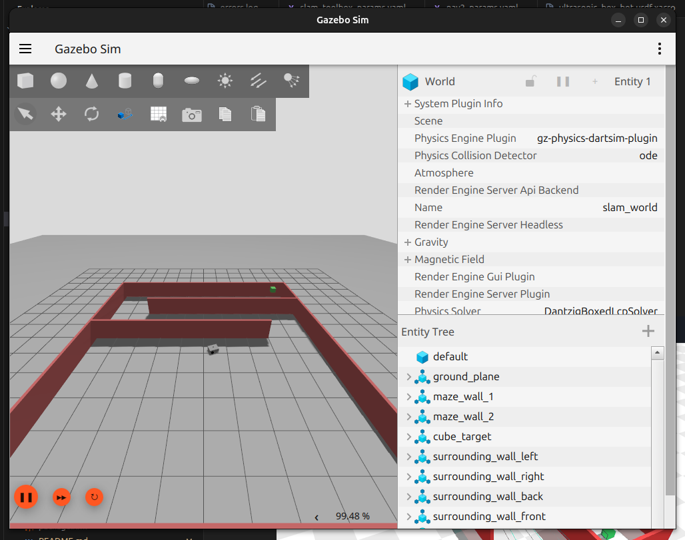
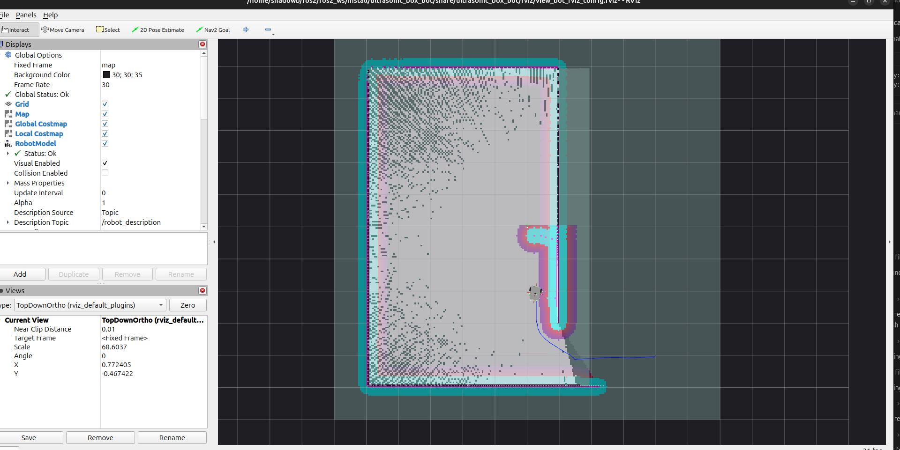
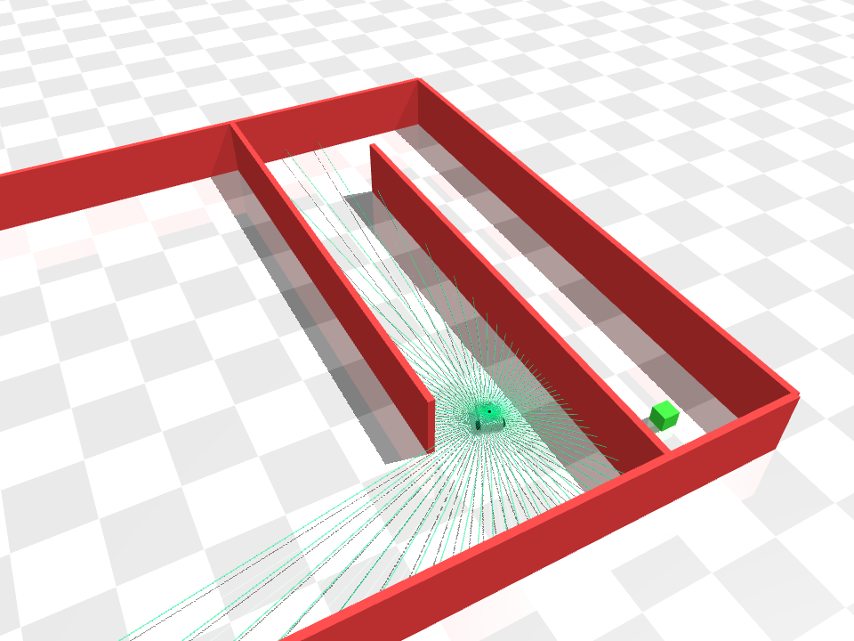
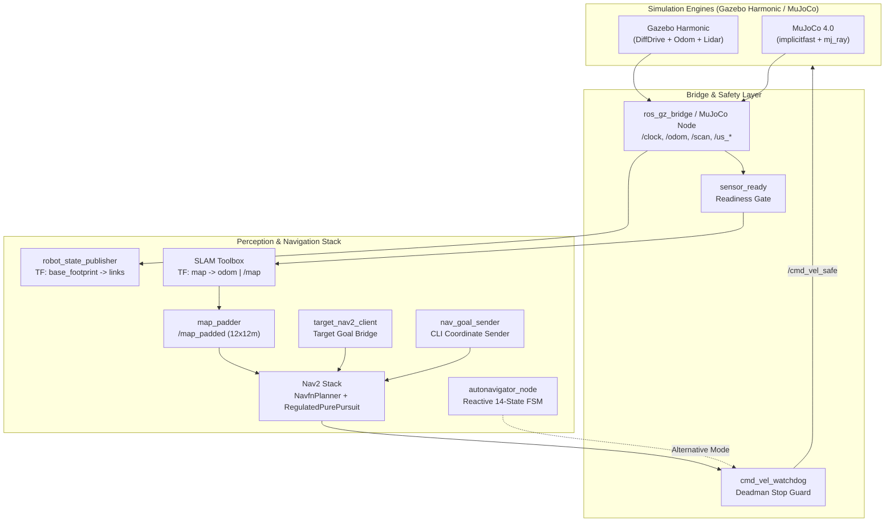

# Autonomous Mobile Robot (`ultrasonic_box_bot`)

<div align="center">

[](https://docs.ros.org/en/jazzy/)
[-orange.svg?style=flat-square)](https://gazebosim.org/home)
[](https://mujoco.org/)
[](https://en.cppreference.com/)
[](https://www.python.org/)
[](LICENSE)
[]()

**A production-grade differential-drive mobile robot stack featuring Dual-Engine Simulation (Gazebo Harmonic & MuJoCo 4.0), real-time SLAM Toolbox mapping, Nav2 autonomous trajectory planning, and a reactive ultrasonic wall-following state machine.**

---

### Rover Autonomous Navigation Demo

*Synchronized autonomous navigation: MuJoCo 3D physics with raycast LiDAR perception (left) coupled with ROS 2 SLAM Toolbox occupancy mapping and Nav2 trajectory tracking (right).*

</div>

---

## Visual Gallery: Simulation & Perception Environments

| **Gazebo Harmonic (gz-sim)** | **RViz2 Mapping & Nav2** | **MuJoCo 4.0 Physics** |
| :---: | :---: | :---: |
| [](src/ultrasonic_box_bot/docs/media/navigation_gazebo.png) | [](src/ultrasonic_box_bot/docs/media/navigation_rviz.png) | [](src/ultrasonic_box_bot/docs/media/navigation_mujoco.png) |
| *3D arena maze with physical target cube, differential drive dynamics, and multi-sensor bridge.* | *Live SLAM occupancy grid, local/global costmaps, 360° LiDAR rays, and active Nav2 path.* | *Sub-millisecond contact physics, native raycast LiDAR sweep, and ultrasonic sensor cones.* |

---

## Table of Contents
- [Key Features & Highlights](#key-features--highlights)
- [System Architecture & Data Flow](#system-architecture--data-flow)
- [Dual Simulation Engines Comparison](#dual-simulation-engines-comparison)
- [Robot Kinematics & Specifications](#robot-kinematics--specifications)
- [Repository Structure](#repository-structure)
- [Prerequisites & Installation](#prerequisites--installation)
- [Quick Start: Running the System](#quick-start-running-the-system)
  - [1. Launch with Gazebo Harmonic](#1-launch-with-gazebo-harmonic)
  - [2. Launch with MuJoCo 4.0](#2-launch-with-mujoco-40)
  - [3. Interactive Target Goal via CLI](#3-interactive-target-goal-via-cli)
  - [4. Reactive Ultrasonic Wall-Follower FSM](#4-reactive-ultrasonic-wall-follower-fsm)
  - [5. Saved-Map Localization (AMCL)](#5-saved-map-localization-amcl)
- [ROS 2 Interfaces & Parameters](#ros-2-interfaces--parameters)
- [Automated Testing & Verification](#automated-testing--verification)
- [License](#license)

---

## Key Features & Highlights

- **Dual-Engine Simulation Support**:
  - **Gazebo Harmonic (`gz-sim`)**: Full ROS-GZ bridge (`ros_gz_bridge`) transporting sensor scans, joint states, odometry, and clock.
  - **MuJoCo 4.0+**: Native Python node (`mujoco_simulator_node.py`) with `implicitfast` velocity integrator, sub-millisecond physics stepping, and custom `mj_ray()` LiDAR / ultrasonic sensor simulation.
- **Multi-Sensor Perception**:
  - **360° 2D LiDAR**: Planar laser scan (`361` samples, $0.08\text{ m} - 10.0\text{ m}$) publishing standard `sensor_msgs/msg/LaserScan` for mapping and obstacle clearance.
  - **4x Directional Ultrasonic Sensors**: Front, back, left, and right range sensors with $30^\circ$ FOV cones for reactive proximity detection and emergency stopping.
- **Autonomous Navigation & Mapping (SLAM + Nav2)**:
  - **Always-Live Mapping**: SLAM Toolbox dynamically generates an occupancy grid (`/map`) and broadcasts `map -> odom` without requiring pre-recorded map files.
  - **Arena-Sized Planning Bounds**: Custom `map_padder` node republishes `/map` inside a fixed $12\text{ m} \times 12\text{ m}$ window (`/map_padded`), preventing global costmap resizing crashes and allowing planning through unexplored regions (`allow_unknown: true`).
  - **Target Navigation Client**: `target_nav2_client` transforms `/target_cube/pose` into the map frame and commands Nav2 via `NavigateToPose`.
  - **Command-Line Navigation Sender**: `nav_goal_sender <x> <y> [yaw]` provides one-shot coordinate navigation directly from the CLI.
- **Reactive Autonomy & Safety**:
  - **Ultrasonic Wall-Following FSM**: `autonavigator_node`, a 14-state reactive controller that negotiates the maze using ultrasonic range sensors and odometry yaw.
  - **Watchdog Deadman Switch**: `cmd_vel_watchdog` monitors `/cmd_vel` and injects zero-velocity commands on stream silence, preventing the simulator from holding stale velocities.
  - **Deterministic Readiness Gates**: `sensor_ready` and `navigation_ready` ensure nodes start only when prerequisite sensor streams and TF frames are active.

---

## System Architecture & Data Flow



---

## Dual Simulation Engines Comparison

| Feature | Gazebo Harmonic (`gz-sim`) | MuJoCo 4.0 (`mujoco_simulator_node`) |
|---|---|---|
| **Physics Backend** | DART / ODE / Bullet | MuJoCo Multibody Dynamics (`implicitfast`) |
| **Integration** | `ros_gz_bridge` + C++ plugins | Direct Python bindings + `rclpy` |
| **LiDAR Simulation** | GPU / Ogre-based ray sensor plugin | CPU raycasting via native `mj_ray()` |
| **Ultrasonic Simulation** | 4 discrete Gazebo range sensors | Multi-ray angular cone raycasting |
| **Performance** | Real-time (1.0x) | Accelerated (1.0x – 5.0x headless) |
| **Ideal For** | High-fidelity rendering & ROS ecosystem parity | Rapid RL training, testing & lightweight execution |

---

## Robot Kinematics & Specifications

<div align="center">

```text
       ┌───────────[ Front (+X) ]───────────┐
       │             ▲                      │
       │         [us_front]                 │
       │             │                      │
       │       [Caster Wheel]               │
       │                                    │
[+Y]   │          [2D LiDAR]                │   [-Y]
[us_left]             │                [us_right]
       │                                    │
       │  [Left Wheel]    [Right Wheel]     │
       │      │                 │           │
       │      └─────── L ───────┘           │
       │             │                      │
       │         [us_back]                  │
       └────────────────────────────────────┘
```

</div>

### Differential Drive Kinematics
Given commanded linear velocity $v$ and angular velocity $\omega$:
$$\omega_L = \frac{v - \frac{\omega \cdot L}{2}}{R}, \quad \omega_R = \frac{v + \frac{\omega \cdot L}{2}}{R}$$

- **Wheel Radius ($R$)**: $0.06\text{ m}$
- **Wheel Separation / Track ($L$)**: $0.34\text{ m}$
- **Chassis Dimensions**: $0.40\text{ m (L)} \times 0.30\text{ m (W)} \times 0.15\text{ m (H)}$
- **Robot Mass**: $5.0\text{ kg}$ chassis + $0.3\text{ kg}$ per wheel
- **LiDAR Height**: $0.185\text{ m}$ above ground level
- **Ultrasonic FOV**: $30^\circ$ cone, range $0.02\text{ m} - 4.0\text{ m}$

### Coordinate Frames & TF Tree
```text
map ──(SLAM Toolbox / AMCL)──► odom ──(DiffDrive / MuJoCo)──► base_footprint ──(Fixed)──► base_link
                                                                                           ├─ left_wheel_link
                                                                                           ├─ right_wheel_link
                                                                                           ├─ caster_wheel_link
                                                                                           ├─ lidar_link
                                                                                           └─ us_{front,back,left,right}
```

---

## Repository Structure

```
ultrasonic_box_bot/
├── CMakeLists.txt                  # Package build definitions & export rules
├── package.xml                     # ROS 2 dependency declarations
├── README.md                       # Repository documentation
├── config/
│   ├── nav2_params.yaml            # Nav2 stack, costmaps & controller configurations
│   └── slam_toolbox_params.yaml    # SLAM Toolbox online asynchronous parameters
├── docs/
│   └── media/                      # Demo GIFs, simulation captures & architectural assets
│       ├── rover_navigation.gif    # Dual-view navigation animation
│       ├── navigation_gazebo.png   # Gazebo Harmonic 3D screenshot
│       ├── navigation_rviz.png     # RViz2 mapping and path visualization
│       └── navigation_mujoco.png   # MuJoCo raycast perception render
├── launch/
│   ├── gz_sim_launch.py            # Master launch for Gazebo Harmonic + Nav2 + SLAM
│   ├── mujoco_sim_launch.py        # Master launch for MuJoCo 4.0 + Nav2 + SLAM
│   ├── rviz_only_launch.py         # Standalone RViz visualization launch
│   └── save_map_launch.py          # Utility to serialize live SLAM map (.yaml + .pgm)
├── rviz/
│   └── view_bot_rviz_config.rviz   # Default RViz display profile
├── scripts/
│   ├── mujoco_simulator_node.py    # MuJoCo 4.0 physics and raycast ROS 2 node
│   ├── train_rl.py                 # RL training loop for autonomous navigation
│   └── box_bot_env.py              # Gymnasium reinforcement learning environment
├── src/
│   ├── autonavigator_node.cpp      # 14-state reactive ultrasonic wall-following FSM
│   ├── cmd_vel_watchdog.cpp        # Safety node injecting zero-twist on command timeout
│   ├── map_padder.cpp              # Map windowing node ensuring fixed 12x12m costmap
│   ├── nav_goal_sender.cpp         # CLI tool sending NavigateToPose goals
│   ├── navigation_ready.cpp        # Readiness gate for map & localization frames
│   ├── sensor_ready.cpp            # Readiness gate for /scan and /odom before SLAM
│   ├── target_cube_publisher.cpp   # Target pose publisher (geometry_msgs/PoseStamped)
│   ├── target_cube_listener.cpp    # Target pose logger subscriber
│   ├── target_nav2_client.cpp      # Goal client converting target pose -> Nav2 action
│   ├── lidar_detector.cpp          # 2D LiDAR diagnostic proximity detector
│   └── ultrasonic_listener.cpp     # Proximity listener & emergency stop demo
├── tests/                          # Automated integration test suite
├── urdf/
│   └── ultrasonic_box_bot.urdf.xacro # Parametric robot model with sensor definitions
└── worlds/
    ├── slam_world.sdf              # Gazebo Harmonic simulation arena & target cube
    └── mujoco/
        ├── slam_world.xml          # MuJoCo XML equivalent of the arena world
        └── ultrasonic_box_bot.xml  # MuJoCo robot model description
```

---

## Prerequisites & Installation

### Operating System & Dependencies
- **Ubuntu 24.04 LTS**
- **ROS 2 Jazzy Jalisco**
- **Gazebo Harmonic (`gz-sim`)**
- **Python 3.12** with virtual environment

```bash
# Update and install ROS 2 core packages
sudo apt-get update
sudo apt-get install -y \
  ros-jazzy-ros-gz \
  ros-jazzy-ros-gz-bridge \
  ros-jazzy-ros-gz-sim \
  ros-jazzy-robot-state-publisher \
  ros-jazzy-rviz2 \
  ros-jazzy-xacro \
  ros-jazzy-slam-toolbox \
  ros-jazzy-nav2-bringup
```

### Workspace Build
From your ROS 2 workspace root (`~/ros2/ros2_ws`):

```bash
source /opt/ros/jazzy/setup.bash
colcon build --packages-select ultrasonic_box_bot
source install/setup.bash
```

---

## Quick Start: Running the System

### 1. Launch with Gazebo Harmonic
Launch the complete Gazebo Harmonic simulation with live SLAM mapping, Nav2 trajectory planner, and RViz:

```bash
ros2 launch ultrasonic_box_bot gz_sim_launch.py
```

- **Startup Sequence**: Gazebo starts $\rightarrow$ `sensor_ready` waits for live sensor data $\rightarrow$ SLAM Toolbox activates $\rightarrow$ Nav2 initializes $\rightarrow$ `target_nav2_client` commands navigation toward the green cube at $(4.0, -4.0)$.

### 2. Launch with MuJoCo 4.0
Launch using the ultra-fast MuJoCo physics engine with native raycast LiDAR:

```bash
ros2 launch ultrasonic_box_bot mujoco_sim_launch.py
```

- To run MuJoCo in interactive GUI mode:
  ```bash
  ros2 launch ultrasonic_box_bot mujoco_sim_launch.py headless:=false
  ```

### 3. Interactive Target Goal via CLI
Command the rover to any coordinate in the arena without modifying launch files:

```bash
# Drive to (4.0, 4.0)
ros2 run ultrasonic_box_bot nav_goal_sender 4.0 4.0

# Drive to (2.0, -1.0) with a specific heading (yaw in radians)
ros2 run ultrasonic_box_bot nav_goal_sender 2.0 -1.0 1.57
```

`nav_goal_sender` connects to Nav2's `NavigateToPose` action, monitors execution feedback, and returns exit code `0` on success.

### 4. Reactive Ultrasonic Wall-Follower FSM
Run the deterministic 14-state reactive state machine instead of Nav2:

```bash
ros2 launch ultrasonic_box_bot gz_sim_launch.py use_autonav:=true
```

### 5. Saved-Map Localization (AMCL)
If navigating on a pre-recorded map with AMCL instead of live SLAM:

```bash
# 1. Save the map during a live SLAM session
ros2 launch ultrasonic_box_bot save_map_launch.py map_name:=my_maze_map

# 2. Launch in localization mode
ros2 launch ultrasonic_box_bot gz_sim_launch.py \
  localization:=true map:=/path/to/my_maze_map.yaml
```

---

## ROS 2 Interfaces & Parameters

### Core Topics
| Topic | Message Type | Purpose |
|---|---|---|
| `/scan` | `sensor_msgs/msg/LaserScan` | 360° LiDAR scan for SLAM & Nav2 costmaps |
| `/odom` | `nav_msgs/msg/Odometry` | Wheel odometry pose & twist |
| `/tf` | `tf2_msgs/msg/TFMessage` | Dynamic transforms (`odom -> base_footprint`) |
| `/cmd_vel` | `geometry_msgs/msg/Twist` | Velocity command from Nav2 or FSM |
| `/cmd_vel_safe` | `geometry_msgs/msg/Twist` | Watchdog-verified velocity sent to simulator |
| `/us_{front,back,left,right}` | `sensor_msgs/msg/LaserScan` | Directional ultrasonic range measurements |
| `/map` | `nav_msgs/msg/OccupancyGrid` | Live SLAM occupancy map |
| `/map_padded` | `nav_msgs/msg/OccupancyGrid` | Fixed $12\text{ m} \times 12\text{ m}$ costmap input |
| `/target_cube/pose` | `geometry_msgs/msg/PoseStamped` | Ground-truth mission target coordinate |

### Launch Arguments
| Argument | Default | Description |
|---|---|---|
| `use_autonav` | `false` | Run reactive ultrasonic FSM instead of Nav2 |
| `localization` | `false` | `false`: always build map live with SLAM; `true`: load saved map with AMCL |
| `map` | `''` | Path to map YAML file (required when `localization:=true`) |
| `use_rviz` | `true` | Launch RViz2 GUI |
| `use_nav2_goal_client` | `true` | Forward `/target_cube/pose` to Nav2 `NavigateToPose` |
| `cmd_vel_timeout` | `0.5` | Watchdog silence threshold before issuing zero-stop (seconds) |
| `target_x` | `4.0` | Target cube X coordinate (meters) |
| `target_y` | `-4.0` | Target cube Y coordinate (meters) |
| `headless` | `true` | (MuJoCo only) Run physics headless without GLFW viewer |

---

## Automated Testing & Verification

The package includes isolated integration tests that validate nodes without requiring a graphical simulator:

```bash
# Run tests
colcon test --packages-select ultrasonic_box_bot --event-handlers console_direct+

# Inspect test results
colcon test-result --verbose
```

### Test Coverage
- **`test_cmd_vel_watchdog.py`**: Verifies velocity forwarding and confirms zero-twist injection when commands stop for $\ge 0.5\text{ s}$.
- **`test_target_nav2_client.py`**: Verifies that new target poses trigger exactly one `NavigateToPose` action goal transformed into the `map` frame.
- **`test_autonavigator.py`**: Tests emergency stop behavior within proximity zones and verifies failsafe behavior on stale data.
- **`test_map_padder.py`**: Verifies that `/map_padded` covers the full arena ($12\text{ m} \times 12\text{ m}$) with unknown padding cells while preserving SLAM occupancy.
- **`test_nav_goal_sender.py`**: Tests CLI argument parsing and single-shot goal issuance.

---

## License

This project is licensed under the **Apache 2.0 License** — see the [LICENSE](LICENSE) file for details.
